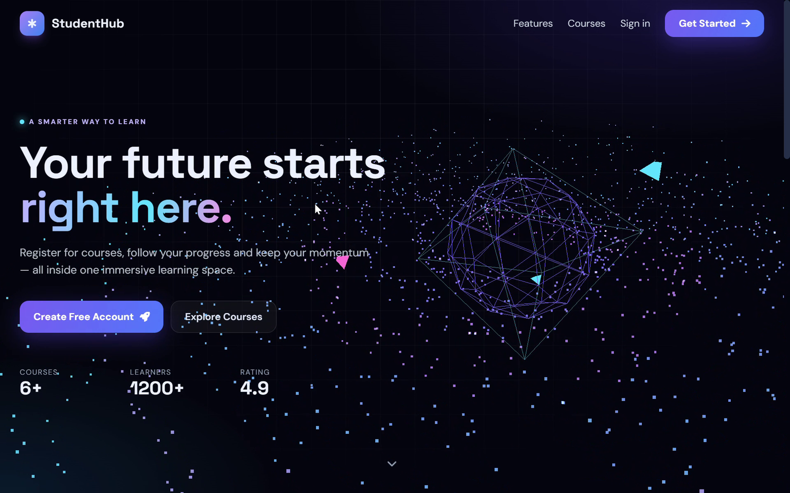
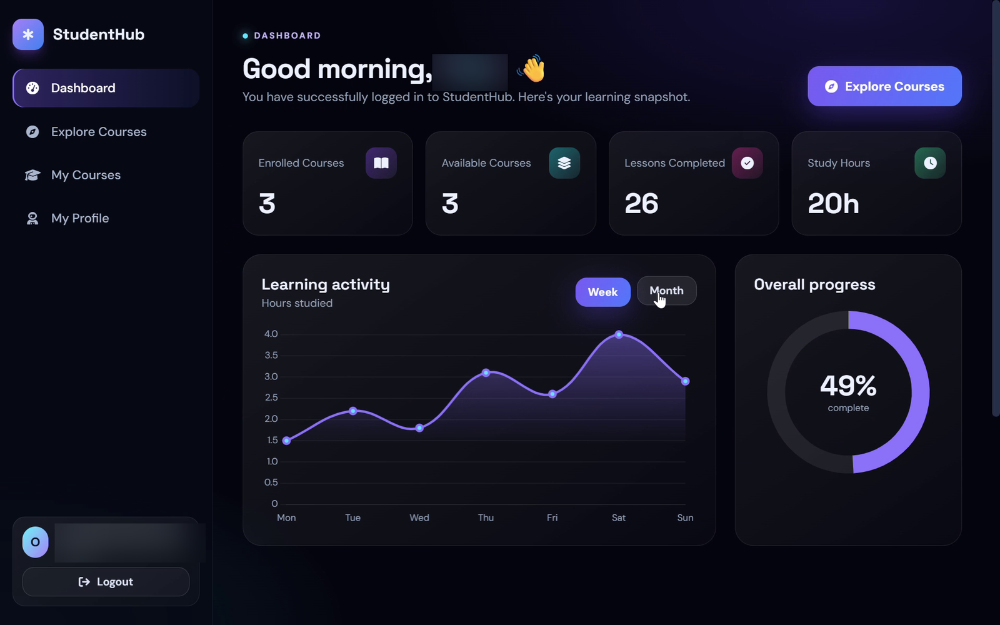
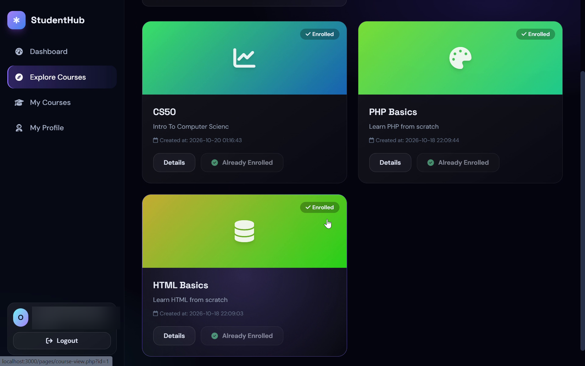
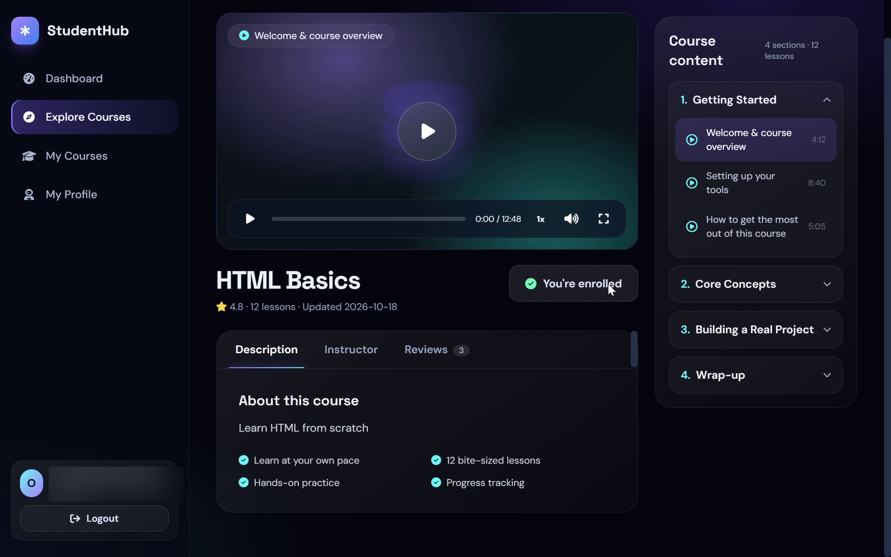
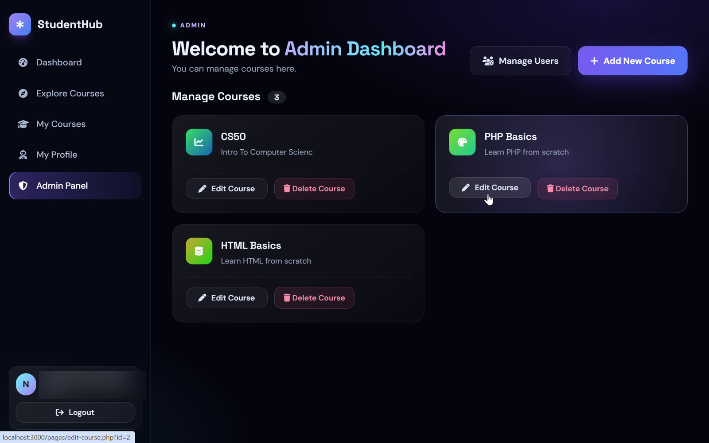
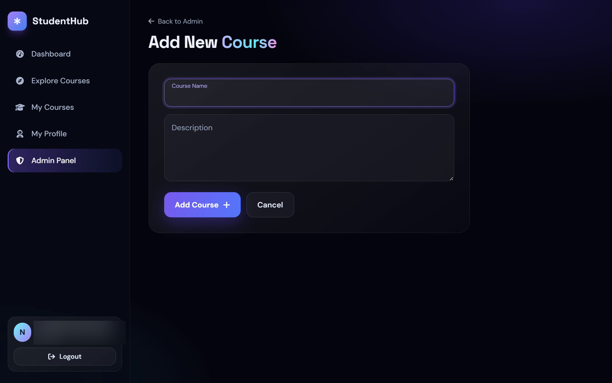

🎓 StudentHub
Learn. Explore. Grow.
A modern learning platform — built with PHP, containerized with Docker, and deployed on AWS.

     

Explore the App  •  View AWS Architecture  •  Tech Stack

✦ Overview
StudentHub is a responsive web application for discovering courses and managing student learning. It includes student authentication, course enrollment, personal dashboards, and an administration panel.

The project also demonstrates a practical two-tier AWS architecture: a containerized PHP application on Amazon EC2, connected to Amazon RDS MySQL in private subnets.

📸 Project Preview

    <b>01 / Landing Experience</b> 

<table> <tr> <td align="center" width="50%">   <b>02 / Student Dashboard</b> </td> <td align="center" width="50%">   <b>03 / Course Catalog</b> </td> </tr> <tr> <td align="center">   <b>04 / Learning Experience</b> </td> <td align="center">   <b>05 / Admin Dashboard</b> </td> </tr> </table> 
 
<b>See more — Course Management</b>
   
  
 

☁️ AWS Architecture

    Architecture overview — public web layer and private database layer 

Request flow

Browser → DuckDNS → Elastic IP → Caddy / HTTPS
                                   ↓
                         EC2 · Docker · PHP/Apache
                                   ↓  MySQL :3306
                         Amazon RDS · Private Subnet
Layer	Implementation
Web	Amazon EC2 running a Dockerized PHP / Apache application
Networking	Custom VPC with public and private subnets across two Availability Zones
Database	Amazon RDS MySQL, Single-AZ, with public access disabled
Routing & TLS	DuckDNS, Elastic IP, and Caddy reverse proxy
Administration	AWS Systems Manager Session Manager — no inbound SSH required
Source Control	Private GitHub repository and read-only EC2 deploy key
✨ Key Features
Student experience: Sign up, sign in, browse courses, enroll, and access a personal dashboard.
Admin experience: Manage courses and access the administration panel.
Database migration: Moved application data from Docker MySQL to Amazon RDS.
Responsive interface: Designed for desktop and mobile screens.
🛠️ Tech Stack
Category	Technologies
Frontend	HTML5, CSS3, JavaScript, Tailwind CSS
Backend	PHP, PDO, Apache
Database	MySQL 8, Amazon RDS
Infrastructure	AWS EC2, VPC, Security Groups, Elastic IP
DevOps	Docker, Docker Compose, Caddy, Git, GitHub
Operations	AWS Systems Manager, RDS automated backups
🔐 Security & Reliability
Database isolation: RDS is deployed in private subnets with no public database access.
Least-privilege access: The application uses a dedicated MySQL account; port 3306 is restricted to the EC2 security group.
Secrets handling: Database credentials are provided through an untracked .env file.
Encrypted storage & backups: RDS encryption at rest and automated backups are enabled.
Server access: AWS Systems Manager avoids exposing SSH to the internet.
⚙️ Deployment Notes
This repository documents the AWS-hosted deployment. The current Docker Compose configuration uses an external, private RDS endpoint and environment variables (RDS_DB_HOST, RDS_APP_PASSWORD). It is not a standalone local deployment without equivalent database access and configuration.

The original Docker MySQL volume was retained during migration as a temporary rollback option. Never commit .env files, credentials, or database backups.

Built by Naser Bader
Web Development · Cloud · DevOps

GitHub Profile  ·  StudentHub Repository

Designed, developed, and deployed as a hands-on cloud engineering portfolio project.

